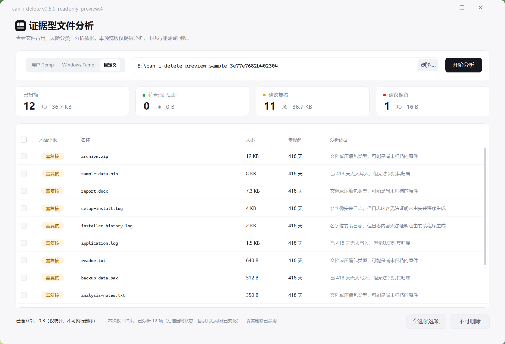
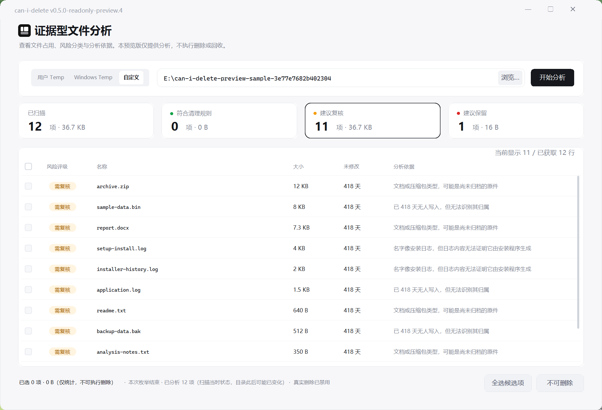

# can-i-delete v0.5.0 Read-only Preview

**免费 Windows 文件分析工具，只读便携预览版。没有一键清理，没有软件内删除或回收功能。**

它帮助你查看文件大小、类别推断和证据不足说明，再由你自行判断和处理文件。
“符合清理规则”“建议复核”“建议保留”是分析分类，不是绝对安全删除承诺。

## 下载与运行

1. 从本项目 Release 下载 `can-i-delete-v0.5.0-readonly-preview-win.zip`。
2. 完整解压到你有权限访问的文件夹，再双击其中的 `can-i-delete.exe`。
3. 不需要安装器、Python、Node.js，也没有自动更新器。需要 Windows 自带或已安装的 **.NET Framework 4.8 或更高的 4.x 版本**；现代 .NET 6/8/9 不替代它。
4. 建议以普通用户身份运行，不必主动选择“以管理员身份运行”。程序清单为 `asInvoker`，不请求提权；但本次验证是在管理员会话中完成，**普通非管理员运行尚未实际验证**。
5. EXE 尚未代码签名，下载后 Windows/SmartScreen 可能提示发布者未知。请先核对本 Release 的 SHA-256；校验只能确认文件一致，不等于安全保证。不要为了运行而关闭安全软件。

公开下载仓库：<https://github.com/Feli999ovo/can-i-delete-preview>。
[下载 v0.5.0 Read-only Preview](https://github.com/Feli999ovo/can-i-delete-preview/releases/tag/v0.5.0-readonly-preview.4)

此公开仓库仅分发 Windows 二进制、许可和使用文档，**不提供应用源码，不宣称源码已公开**。

## 能做什么

- 扫描用户 Temp、Windows Temp，或通过“浏览…”选择的文件夹。
- 查看已扫描、符合清理规则、建议复核、建议保留四类统计。
- 点击统计卡筛选结果；点击“大小”列标题切换大小排序。
- 点击结果查看证据；双击文件行，或使用证据面板的“在文件夹中定位”，在资源管理器中选中目标，不打开或执行目标文件。
- 预算触顶且仍可续扫时使用“继续分析”；扫描过程中可取消。

## 使用方法

启动后默认分析当前用户 Temp。也可选择自己的文件夹，再点“开始分析”。

1. 看统计卡和结果列表。目录体积或枚举未完成时，界面会注明不完整；未知剩余数量不代表零。
2. 点“建议复核”等统计卡缩小显示范围。筛选、排序只改变显示，不处理文件。
3. 查看文件证据和“证据不足”原因。软件归属推断不等于已经确认真实归属。
4. 用定位功能在资源管理器中找到文件；是否保留、备份或删除，由你自行决定。重要文件应先备份。
5. 达到单轮预算时，如按钮显示“继续分析”，及时点击。继续分析只在当前会话中有效，不支持关窗后恢复。

## 只读范围

- `BuildAllowsRealDeletion=false`，`ExecutionAllowed=false`。
- 删除按钮禁用；勾选只用于统计，**不能执行删除或移入回收站**。
- 分析代码不创建、写入、移动、重命名或删除被扫描对象，也不向扫描目录写日志。
- 文件系统或其他程序可能在扫描期间变化；读取还可能由 Windows 更新访问时间等系统元数据。因此结果是扫描当时的观察，不是目录永久不变的保证。
- 界面为“证据型文件分析”；副标题明确说明仅提供分析，不执行删除或回收。底栏禁用按钮写明“不可删除”；窗口标题与底栏同时说明本预览版仅提供分析，勾选只用于统计。
- 没有符合规则的候选项时，“全选候选项”按钮不可用；出现候选项后才可操作。
- 证据抽屉里的“完整路径”可以换行显示全文，也可以点“复制完整路径”一键复制；抽屉里的判定说明用中文表述，技术标识放在括号里作为补充。

## 系统要求与已验证范围

- 发布目标：Windows 11 桌面环境，.NET Framework 4.8+。
- 本机验证：Windows 11 系列 build 26300，x64，.NET Framework 4.8.1，2560×1600 屏幕、150% 缩放，管理员会话。
- EXE 是 .NET Framework 托管 AnyCPU 程序，实际测试仅覆盖 x64。Windows 10、32 位 Windows、ARM64 和其他硬件环境均未做本次兼容实测。
- 建议至少约 1240×845 个有效显示像素（100% 缩放下），并留出任务栏空间；高 DPI 时需要更大物理工作区。小屏幕、跨显示器缩放可能出现裁切或布局拥挤。
- 界面使用 Microsoft YaHei UI、Cascadia Mono 等系统字体；缺少字体时的替代字体可能改变宽度或对齐。
- 受保护目录需要对应读取权限；遇到拒绝访问、系统 I/O 阻塞或网络位置时，不保证完整扫描或固定取消时间。不建议首轮扫描整盘。

## 截图

以下是本版本 EXE 在真实 Windows 桌面上的屏幕截图，内容来自专门生成的无隐私样本，不是扫描真实用户文件，也未使用程序的演示模式。

截图内样本路径仅用于展示；截图说明不构成删除建议。

## 校验、版本与许可

本仓库使用独立的发布说明快照历史，仅分发程序、许可与说明；不继承开发仓库历史。

- Release 外部 `SHA256SUMS.txt` 提供 ZIP 校验值；解压后的同名文件提供 EXE、说明和截图校验值。
- 在 PowerShell 中运行：`Get-FileHash .\can-i-delete-v0.5.0-readonly-preview-win.zip -Algorithm SHA256`。
- 发布标签为 `v0.5.0-readonly-preview.4`，产品来源为提交 `18b4e1a68fe74c1f75055b5f35de4a3f0730854c`，见 `BUILD-INFO.txt`。
- EXE 内部程序集版本与文件版本均为 `0.5.0.4`，产品显示版本为 `v0.5.0-readonly-preview.4`；可用发布标签与 SHA-256 交叉核对。
- 免费，附原项目 MIT 许可与版权声明；详见 `LICENSE`。此处提供许可文本不表示应用源码已在本仓库公开。已知限制见 [RELEASE-NOTES.md](RELEASE-NOTES.md)。
